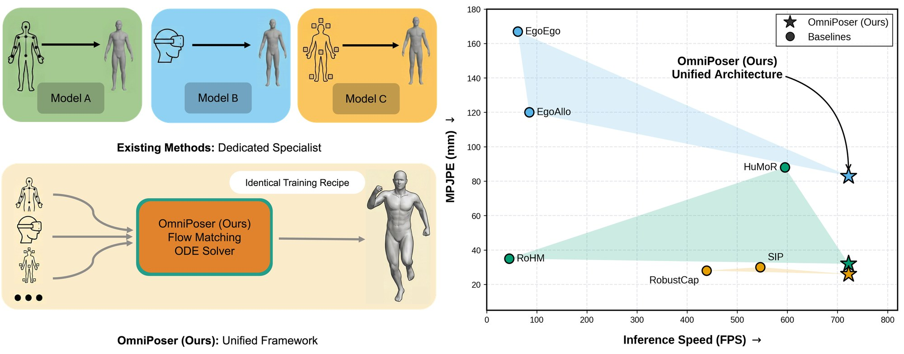

# OmniPoser: Flexible Human Motion Recovery in the Wild with Masked Flow Matching

**ECCV 2026**

[[Paper]](https://arxiv.org/pdf/2610.19857) [[Project Page]](https://jamesbridgewater51.github.io/omniposer-eccv/)

<p align="center">
  
</p>

One model recovers full-body 3D human motion from *any sparse subset* of
heterogeneous observations — 3D keypoints from monocular vision, rotations from
a handful of IMUs, a single head-mounted 6-DoF pose, or any combination of
them — in a single ODE step at over 700 FPS.

## Overview

Wearable sensing gives you whatever a device happens to measure: a few joints
seen by a camera, a few rotations read by IMUs, or just where the head is
pointing. Each signal is a partial view of one and the same body state, so
OmniPoser treats motion recovery as conditional completion of a unified
representation: every observation type is concatenated into one tensor, and a
binary visibility mask marks which entries are real.

Zeroing out the missing entries, however, destroys the identity of unobserved
joints. A Masked Conditioning Encoder (MCE) therefore replaces each missing
joint with a learnable per-joint embedding, so the network knows *which* joints
it is completing rather than treating all gaps alike.

The generative backbone is a decoupled dual stream trained with Conditional
Flow Matching: a temporal-convolutional UNet recovers the global trajectory, a
cross-attention DiT recovers body pose conditioned on it. At inference, a
single Euler integration step maps Gaussian noise onto the motion manifold —
no iterative sampling, real-time by construction.

## Installation

```bash
pip install -r requirements.txt
```

Tested with Python 3.10, PyTorch 2.x, CUDA 12.x.

## Data Preparation

Preprocess each dataset into the unified SMPL-X neutral format (see
`preprocessing_*.py`). The default layout expected by the configs is:

```
data/
├── amass/           # preprocessing_amass.py output
├── hps/             # preprocessing_hps.py output
├── mocap/           # preprocessing_mocap.py output (AIST++, TotalCapture)
├── rich/            # preprocessing_rich.py output
├── nymeria/         # preprocessing_nymeria.py output
└── body_models/     # SMPL-X neutral model files
```

```bash
python preprocessing_amass.py --amass_root <raw AMASS> --save_root data/amass/preprocessed
```

Nymeria preprocessing additionally requires the Nymeria SMPL processor
(mvnx_to_smpl), placed under `third_party/nymeria_smpl_processor/`.

## Training

Train the flow-matching model on AMASS (default):

```bash
python main_train.py training=flow_matching model/trajnet=tcn_generative model/posenet=dit_generative training_model=flow_matching
```

Train on all three datasets:

```bash
python main_train.py training=flow_matching model/trajnet=tcn_generative model/posenet=dit_generative training_model=flow_matching dataset/train=amass_hps_rich dataset/test=amass_hps_rich
```

The observation pattern is selected with the masking config. A specialist
trained on a single pattern:

```bash
python main_train.py ... masking=rohm_upper_body_xyz
```

The unified model (Ours-U) samples a mixture of patterns during training:

```bash
python main_train.py ... masking=generalist_mixed
```

Available masking schemes are listed under `cfg_files/conf/masking/`.

## Evaluation

```bash
python test.py logdir=runs/<your_run> dataset=amass
python test.py logdir=runs/<your_run> dataset=aist
```

Metrics (MPJPE, PA-MPJPE, acceleration, jerk, contact, skating, penetration,
translation, hips & shoulders rotation) are computed by `utils/evaluation.py`
and written to the run's output directory.

## Acknowledgements

This codebase is built on [RoHM](https://github.com/uchikay/rohm) and benefits
from its evaluation protocol and SMPL utilities. We thank the authors of RoHM
for releasing their code.

## Citation

If you find this work useful, please cite:

```bibtex
@inproceedings{liu2026omniposer,
  author    = {Liu, Minghao and Tang, Tutian},
  title     = {OmniPoser: Flexible Human Motion Recovery in the Wild with Masked Flow Matching},
  booktitle = {European Conference on Computer Vision (ECCV)},
  year      = {2026}
}
```

## License

This project is released under the CC BY-NC 4.0 license (see `LICENSE.md`),
inherited from the RoHM codebase it builds upon. Commercial use is not
permitted.
